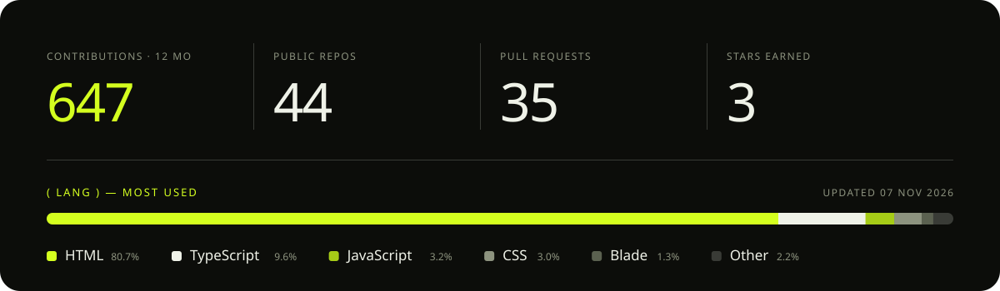
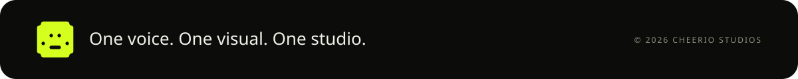

  <a href="https://www.cheeriostudios.com/pages/baibu-cinema/panel/"><b>SDMT panel walkthrough</b></a> ·
  <a href="https://www.cheeriostudios.com/pages/key-leaves/"><b>Key Leaves case study</b></a> ·
  <a href="https://github.com/cheerios-design/express-supabase-events-api"><b>express-supabase-events-api</b></a>

| Code worth a look | Stack | What it shows |
|---|---|---|
| [express-supabase-events-api](https://github.com/cheerios-design/express-supabase-events-api) | Express 5 · TypeScript · Supabase | Row-level security, race-safe booking in Postgres, 36 tests, CI |
| [games-vault-api](https://github.com/marsil1990/games-vault-api) | Node · Express · MongoDB | REST API with Google OAuth, Swagger docs and Jest (team project) |
| [CheerioStudiosMain](https://github.com/cheerios-design/CheerioStudiosMain) | Next.js · React · Tailwind | This studio's site: static export, deploys through GitHub Actions |
| [FluentFocus](https://github.com/cheerios-design/FluentFocus) | Next.js · Prisma · PostgreSQL | TOEFL/IELTS vocabulary app with its own data pipeline |
| [BrandGridMobile](https://github.com/cheerios-design/BrandGridMobile) | React Native · Expo · TypeScript | Brand palette inspector with on-device storage |
| [cse341](https://github.com/cheerios-design/cse341) | Node · Express · MongoDB | Web services with GitHub OAuth, sessions and Swagger |

   
  
    
  
    
  
    
  
    

   
  
    
  
    

   
  
  
  
  
    

  

